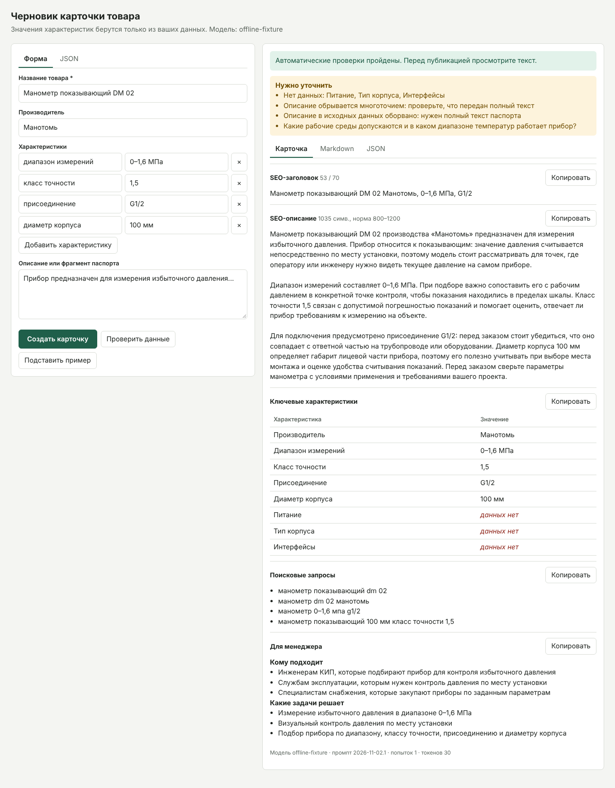

# AI-помощник для карточек товаров

Сервис получает данные о контрольно-измерительном приборе и готовит черновик карточки для B2B-магазина: SEO-заголовок, SEO-описание, таблицу характеристик, поисковые запросы и блок для менеджера. Значения характеристик берутся только из входных данных, а отсутствующие помечаются как «данных нет».



## Быстрый старт

Нужны Python 3.11+ и ключ [Anthropic API](https://platform.claude.com/).

```bash
python -m venv .venv
source .venv/bin/activate        # Windows: .venv\Scripts\activate
pip install -r requirements.txt
cp .env.example .env             # затем впишите ANTHROPIC_API_KEY в .env
python -m cardgen serve
```

Форма откроется на http://127.0.0.1:8000. Кнопка «Подставить пример» заполнит её данными манометра.

## Использование

### Командная строка

```bash
# Проверить данные: без LLM и без ключа
python -m cardgen check examples/input/manometer-dm02.json

# Вывести карточку в терминал
python -m cardgen generate examples/input/manometer-dm02.json

# Сохранить .md и .json. В файле может быть один товар или массив товаров
python -m cardgen generate examples/input/*dm02.json examples/input/demo-*.json --out-dir examples/output
```

Коды завершения: `0` — успешно, `1` — ошибка генерации или LLM, `2` — некорректные входные данные.

### HTTP API

```bash
curl -X POST http://127.0.0.1:8000/api/v1/cards \
  -H "Content-Type: application/json" \
  -d @examples/input/manometer-dm02.json
```

| Метод и путь | Назначение |
| --- | --- |
| `POST /api/v1/cards` | Создать карточку |
| `POST /api/v1/check` | Проверить данные без LLM |
| `GET /healthz` | Состояние сервиса и настройка ключа |

Ошибки имеют единый вид: `{"error": {"code", "message", "details", "request_id"}}`.

| HTTP | Код | Когда |
| --- | --- | --- |
| 400 | `invalid_json` | JSON не разбирается; в сообщении указаны строка и позиция |
| 413 / 415 | `http_413` / `unsupported_media_type` | Запрос больше 1 МБ или это не JSON |
| 422 | `invalid_product` | Нет названия, нет ни характеристик, ни описания, неверные типы |
| 502 | `llm_auth_failed`, `llm_request_rejected`, `llm_refusal`, `llm_bad_output` | Ключ или запрос отклонён, модель отказала, ответ не удалось использовать |
| 503 | `not_configured`, `llm_rate_limited`, `llm_unavailable` | Нет ключа, превышен лимит, LLM недоступна |
| 504 | `llm_timeout` | LLM не ответила вовремя |

### Статус результата

- `ready` — автоматические проверки пройдены. Текст всё равно просматривает человек.
- `needs_review` — после всех попыток исправления остались замечания. Они перечислены в `issues` и показаны в форме. Карточка не скрывается, чтобы менеджер мог поправить её вручную.

Поле `missing_fields` перечисляет, что нужно уточнить. Требования задания описаны как типовые, поэтому отсутствие питания или интерфейсов у механического манометра может означать «неприменимо»: это решает менеджер.

## Настройки

Задаются в `.env` или переменными окружения. Файл `.env` указан в `.gitignore`.

| Переменная | По умолчанию | Назначение |
| --- | --- | --- |
| `ANTHROPIC_API_KEY` | — | Ключ API, обязателен для генерации |
| `LLM_MODEL` | `claude-sonnet-5-5` | Модель |
| `LLM_MAX_TOKENS` | `8000` | Лимит токенов ответа |
| `LLM_TIMEOUT_SECONDS` | `120` | Таймаут ответа |
| `LLM_MAX_RETRIES` | `3` | Повторы при сетевых ошибках, 429 и 5xx |
| `CARD_MAX_REPAIRS` | `2` | Сколько раз вернуть карточку модели на исправление |
| `ANTHROPIC_BASE_URL` | `https://api.anthropic.com` | Адрес API |
| `LOG_LEVEL` | `INFO` | Уровень логирования |

## Как это устроено

```text
JSON или форма
  → проверка входа (analysis)   нет данных: стоп, LLM не вызывается
  → LLM с JSON-схемой (llm)     повторы при сбоях сети и API
  → проверка фактов и длин (factcheck)
      есть замечания → модель исправляет, не более CARD_MAX_REPAIRS раз
  → таблица характеристик из входных данных (build_specs)
  → JSON + Markdown (render)
```

```text
cardgen/
  analysis.py   разбор входа, заглушки вроде «н/д», список пробелов
  prompts.py    системный промпт, промпт исправления
  llm.py        клиент API: таймауты, повторы, разбор ошибок
  factcheck.py  проверка ответа модели и сборка таблицы характеристик
  service.py    сценарий генерации и цикл исправления
  render.py     Markdown
  web.py, templates/index.html   API и форма
  cli.py        команды serve, check, generate
tests/          тесты; настоящий HTTP к локальной заглушке вместо LLM
examples/       входные данные и примеры результата
docs/DECISIONS.md   промпты, решения, ограничения
```

## Тесты

```bash
pip install -r requirements-dev.txt
python -m pytest
```

Тесты не тратят токены и не требуют ключа: клиент обращается по настоящему HTTP к локальной заглушке.

## Примеры, промпты и ограничения

- [examples/README.md](examples/README.md): откуда взялись примеры и как их пересоздать.
- [docs/DECISIONS.md](docs/DECISIONS.md): промпты, принятые решения, ограничения и возможные улучшения.
